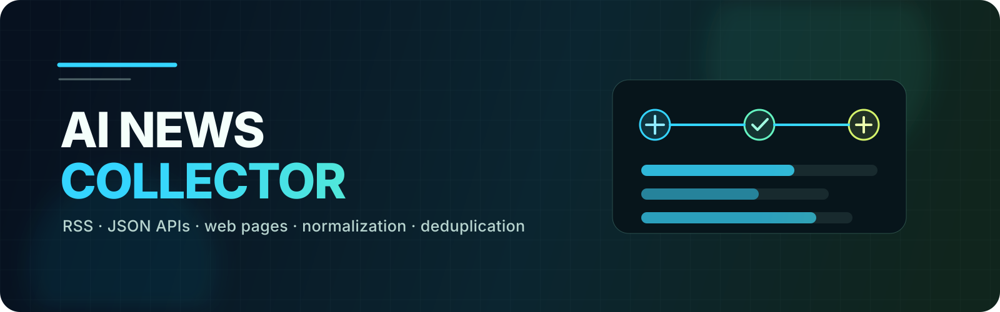
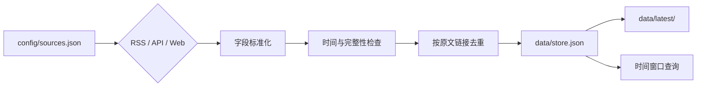

# AI News Collector

[](https://github.com/algiexu/ai-news-collector/actions/workflows/ci.yml)
[](https://nodejs.org/)
[](https://www.python.org/)
[](LICENSE)

一个用脚本采集 AI 资讯的轻量工具。它支持 RSS、JSON API 和需要浏览器的网页来源，统一字段、按原文链接去重，并输出最近资讯、来源状态和历史条目库。采集过程不调用 AI，不依赖数据库。

适合以下场景：

- 定时汇总 AI、科技和产品资讯
- 为选题、研究和内容生产准备候选清单
- 用 Playwright 采集普通 HTTP 请求无法处理的网页
- 在本地或 GitHub Actions 中运行同一套采集流程

## 特点

- **多种来源**：RSS、JSON API、网页，可混合配置。
- **来源级状态**：某个来源失败时，其余来源仍会保存，并在状态文件中明确标记。
- **稳定去重**：按原文链接或兜底标识生成稳定 ID，重复采集只更新同一记录。
- **时间窗口**：从历史条目库筛选 8h、24h、48h 等时间范围。
- **无模型依赖**：采集、整理、去重都由确定性脚本完成。
- **可移植**：公开配置不包含本机路径、个人代理或生产数据。

## 工作方式



每个来源独立记录 `ok`、`blocked` 或 `failed`。失败不会被解释成“没有新闻”，未知发布时间也不会进入最近 24 小时清单。

## 快速开始

要求：

- Node.js 22+
- Python 3.12
- Playwright Chromium

```bash
git clone https://github.com/algiexu/ai-news-collector.git
cd ai-news-collector
npm ci
npx playwright install chromium
npm run sources
npm run collect
```

Linux 首次运行可安装浏览器系统依赖：

```bash
npx playwright install --with-deps chromium
```

采集完成后查看：

- `data/latest/titles.md`
- `data/latest/index.json`
- `data/latest/status.json`
- `data/store.json`

`data/` 已加入 `.gitignore`。这些文件属于运行产物，不会进入仓库。

## 常用命令

| 命令 | 作用 |
| --- | --- |
| `npm run sources` | 查看来源及启用状态 |
| `npm run collect` | 采集全部启用来源 |
| `npm run collect -- --source AIHOT_精选` | 只采集指定来源 |
| `npm run collect -- --out ./output` | 指定本次原始批次目录 |
| `npm run query -- --window 48h` | 从历史条目库查询过去 48 小时 |
| `npm test` | 运行单元测试 |
| `npm run check` | 检查 JavaScript 语法 |

来源管理命令：

```bash
node src/collect.mjs add --name "Example Feed" --kind RSS --url "https://example.com/feed"
node src/collect.mjs disable --name "Example Feed"
node src/collect.mjs enable --name "Example Feed"
node src/collect.mjs remove --name "Example Feed"
```

## 来源配置

默认配置在 [`config/sources.json`](config/sources.json)。每种来源使用 `kind` 区分：

- `RSS`：通过 `src/parse_rss.py` 解析 RSS/Atom。
- `接口`：读取 JSON API，可按 `api.items` 指定条目数组路径。
- `网页`：用 Playwright 打开页面并抽取正文与链接。

`proxy` 支持三种值：

```json
{
  "proxy": false
}
```

```json
{
  "proxy": true
}
```

`true` 会使用环境变量 `NEWS_PROXY`。也可以给单个来源填写代理地址，但不要把含账号密码的代理地址提交到 Git。

需要特殊网络环境的 X 榜单来源默认关闭。启用前先确认当地网络条件和目标站点规则。

## GitHub Actions

- [`ci.yml`](.github/workflows/ci.yml)：推送和 Pull Request 时检查语法并运行测试。
- [`collect.yml`](.github/workflows/collect.yml)：手动采集一次，并把 `data/` 作为 Actions Artifact 上传。

公开版默认不提交采集结果，也不默认开启定时任务。需要长期运行时可复制工作流到自己的私有仓库，并自行配置保存方式。

## 项目结构

```text
.
├── config/
│   └── sources.json
├── src/
│   ├── browser.mjs
│   ├── collect.mjs
│   ├── parse_rss.py
│   ├── query.mjs
│   └── lib/parser.mjs
├── test/
├── docs/
├── examples/
└── .github/workflows/
```

进一步说明：

- [架构与失败语义](docs/architecture.md)
- [数据与第三方内容政策](docs/data-policy.md)

## 已知边界

- RSS/API 返回条数和收录延迟会限制覆盖范围。
- 网页来源依赖目标站点当前 DOM，站点改版后可能需要调整解析逻辑。
- Playwright 不绕过验证码或访问控制；遇到验证墙时只记录失败。
- 采集工具不判断新闻真伪，也不替代原文核实。

## 参与贡献

提交问题前请先阅读 [CONTRIBUTING.md](CONTRIBUTING.md)。安全问题请按照 [SECURITY.md](SECURITY.md) 私下报告。

## 许可证

代码以 [MIT License](LICENSE) 开源。该许可证只覆盖本仓库代码，不授予任何第三方新闻、图片、摘要或网页内容的再发布权。
